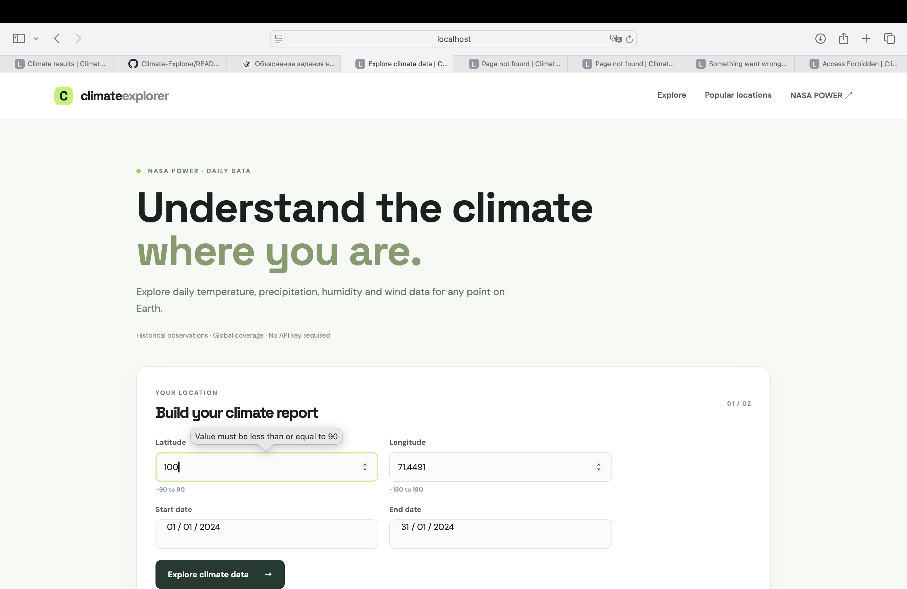
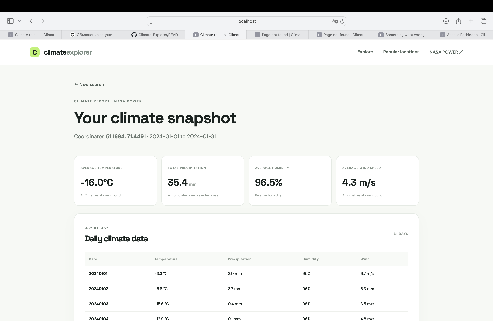
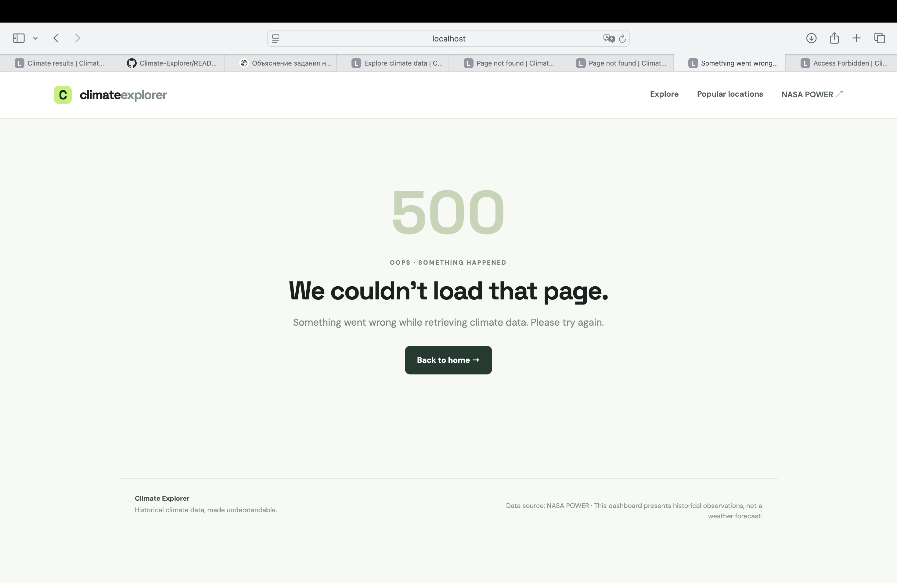

<<<<<<< HEAD
``# Climate Explorer

Climate Explorer is a web application for exploring historical climate data using the NASA POWER API.

## Project Overview

The application allows users to explore historical climate information by entering geographic coordinates and selecting a date range.

## Features

- Search climate data by latitude and longitude.
- Select a custom date range.
- View historical climate results.
- Explore popular locations.
- Input validation for coordinates and dates.
- Custom error pages (403, 404, 500).
- Error handling and request logging.

## Technologies Used

- Node.js
- Express.js
- EJS
- HTML
- CSS
- JavaScript
- NASA POWER API

## Installation

1. Clone the repository.
2. Install dependencies:

```bash
npm install
```

3. Create a `.env` file and configure the required environment variables if needed.
4. Start the application:

```bash
npm start
```

5. Open `http://localhost:3000` in your browser.

## Data Source

NASA POWER API

https://power.larc.nasa.gov/

## Author

Lyaziza


## Screenshots

### Home Page


### Climate Results


### Error Handling (500)

=======
# Climate Explorer — Weather & Climate Data Dashboard

An Express/Node.js web application that retrieves daily historical meteorological data from NASA POWER and presents it in a responsive EJS dashboard.

## Features
- Search by latitude, longitude and date range.
- Two Axios requests with separate NASA POWER parameter sets.
- Daily temperature, precipitation, relative humidity and wind speed.
- Summary calculations: average temperature, total precipitation, average humidity and average wind speed.
- Preset locations, server-side validation, request logging, 404 and centralized error handling.
- Responsive EJS interface and friendly error pages.

## API
NASA POWER Daily Point API: https://power.larc.nasa.gov/docs/services/api/temporal/daily/

Endpoint: `https://power.larc.nasa.gov/api/temporal/daily/point`

The app requests `T2M,PRECTOTCORR` and `RH2M,WS2M` in two separate requests. Date parameters use `YYYYMMDD`. No API key is required.

## Routes
| Method | Route | Purpose |
|---|---|---|
| GET | `/` | Home page and search form |
| POST | `/search` | Validate user input and redirect to results |
| GET | `/results` | Fetch and display climate data |
| GET | `/popular` | Preset coordinates |
| GET | `*` | Custom 404 page |

## Installation
1. Install Node.js (LTS).
2. Clone/download this repository and open the project folder in a terminal.
3. Install dependencies:
   ```bash
   npm install
   ```
4. Copy `.env.example` to `.env`. The default port is 3000.
5. Start the application:
   ```bash
   npm start
   ```
6. Open `http://localhost:3000`.

## Project structure
- `routes/` — Express route definitions
- `controllers/` — request handling and page rendering
- `services/` — Axios integration with NASA POWER
- `middleware/` — logger, validation and error handlers
- `views/` — EJS pages and shared partials
- `public/` — CSS assets

## Screenshots
Add 2–3 screenshots after running the application:
1. Home page with the coordinate/date form.
2. Results page showing summary cards and daily table.
3. Popular locations page.

## AI use disclosure
This project was developed with AI assistance. Review, test and understand every submitted file. Complete the course AI Declaration with the tools used, prompts/tasks, AI-assisted files and the changes/testing you personally performed.

## Notes
NASA POWER daily data is historical analysis-ready data, not a real-time forecast. The API documentation describes daily data availability beginning in 1981. The application limits a query to 365 days to keep requests manageable.
>>>>>>> f2b6e8b (Add Climate Explorer project)
